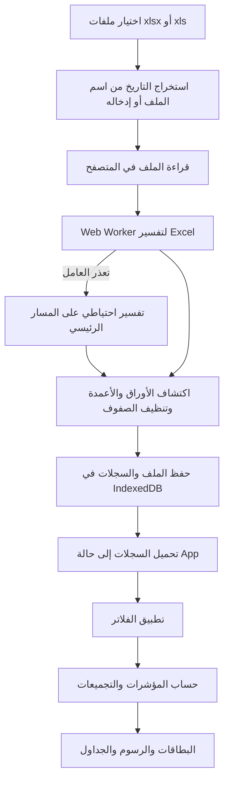

# مرجع تحليل النظام

**آخر مراجعة:** 2026-10-31  
**الحالة:** وصف للتنفيذ الموجود حاليًا، وليس مواصفات نهائية للسلوك المطلوب.

## 1. الهدف والنطاق

التطبيق لوحة تحليل تشغيلية لشحنات Bosta. يستورد تقارير Excel اليومية، يحول صفوفها إلى سجلات شحنات موحدة، يحفظها محليًا في المتصفح، ثم يعرض مؤشرات ورسومًا وفلاتر لاستكشاف الأداء حسب التاريخ والمركز والتاجر والنوع والجغرافيا.

التطبيق واجهة React تعمل في المتصفح. لا يظهر في مسار `src/` الحالي استدعاء مباشر لخدمة Gemini أو API خارجي؛ لكن `@google/genai` و`express` موجودان ضمن الاعتمادات، كما يحتوي `metadata.json` على إشارة إلى Gemini. يلزم مراجعة هذه الاعتمادات والبيانات الوصفية قبل اعتماد وصف أمني أو نشر رسمي.

## 2. البنية وتدفق البيانات



### الوحدات

| المسار | المسؤولية |
| --- | --- |
| `src/main.tsx` | إنشاء React root وتحميل التطبيق وملف الأنماط. |
| `src/App.tsx` | تحميل الحالة، إدارة الملفات والإعدادات والفلاتر، وربط أقسام الواجهة بالتجميعات. |
| `src/components/` | الرفع وإدارة الملفات، الفلاتر، البطاقات، التحليلات الزمنية، أداء المراكز والأعمال، الجغرافيا، مستكشف الشحنات، وملف البيانات. |
| `src/services/excelService.ts` | نقل الملف إلى Web Worker، وإدارة تقدم القراءة/التحليل والرجوع إلى المعالجة الرئيسية عند تعذر العامل. |
| `src/workers/excelWorker.ts` | تشغيل محلل Excel خارج المسار الرئيسي وإرجاع النتيجة أو الخطأ. |
| `src/utils/excelParser.ts` | اكتشاف الأوراق والأعمدة، تنظيف القيم، إزالة تكرار التتبع داخل الملف، وبناء سجلات الشحنات. |
| `src/utils/dateExtractor.ts` | استخراج تاريخ من اسم الملف بصيغ ISO والمضغوطة واليوم-أولًا وأسماء الشهور الإنجليزية. |
| `src/utils/analytics.ts` | تطبيق الفلاتر وحساب المؤشرات والتوزيعات والاتجاهات. |
| `src/services/db.ts` | إنشاء قاعدة IndexedDB وإدارة الملفات والشحنات والإعدادات. |
| `src/types/index.ts` | أنواع الملفات والسجلات والفلاتر ونتائج التجميع. |
| `src/utils/chartSetup.ts` | إعداد Chart.js والتسجيلات والإضافات المخصصة. |

## 3. تدفق استيراد الملفات

1. يقبل مربع الرفع امتدادي `.xlsx` و`.xls` فقط، ويمكن إضافة أكثر من ملف.
2. يحاول النظام استخراج التاريخ من اسم الملف. إذا لم يجده، يضع تاريخ اليوم بصيغة UTC ويتيح للمستخدم تغييره يدويًا.
3. يقرأ الملف كـ `ArrayBuffer`، ثم يرسل البيانات إلى Worker إن كان متاحًا؛ وإلا يستخدم مسارًا احتياطيًا داخل الصفحة.
4. يقرأ المحلل أوراق المصنف، ويختار صف العناوين من أول 15 صفًا باعتباره الصف صاحب أكبر عدد من الخلايا النصية غير الفارغة.
5. يحاول اكتشاف أعمدة التتبع ونوع الشحنة والمدينة والتاجر وغيرها بمطابقة أسماء معروفة. تُكتشف أعمدة المراكز من كلمات مثل `hub` و`facility` و`warehouse`.
6. تُحلل الأوراق التي تحتوي عمود تتبع أو تحصل على درجة اكتشاف لا تقل عن 3. إذا لم توجد ورقة مرشحة، تستخدم الورقة الأعلى تقييمًا ذات الصفوف.
7. الصف ذو رقم تتبع مفقود يُتجاهل عند وجود عمود تتبع. إذا لم يُكتشف عمود التتبع، ينشئ المحلل رقمًا اصطناعيًا للصف.
8. تُزال أرقام التتبع المكررة **داخل الملف نفسه فقط**، مع الاحتفاظ بأول ظهور. تكرار رقم التتبع في ملفات/أيام مختلفة يبقى كسجل منفصل.
9. يُحفظ الملف وسجلاته في معاملة IndexedDB. عند إعادة رفع الاسم نفسه، يُستبدل الملف وسجلاته السابقة.

### هوية الملف والسجل

- `fileId` هو اسم الملف، وليس بصمة محتواه. لذلك إعادة تسمية ملف متطابق تنشئ هوية أخرى، وإعادة استخدام الاسم تستبدل المحتوى السابق.
- معرف سجل الشحنة الحالي هو `${fileId}_${tracking}`. يوصى بتغيير طريقة تركيب المفتاح مستقبلًا لتجنب تصادم محتمل عند احتواء أجزاء الاسم أو رقم التتبع على الفاصل نفسه.
- `shipmentDate` مصدره تاريخ الملف الذي حدده المستخدم أو استخرجه من اسمه، وليس تاريخ الصف داخل Excel.

## 4. التخزين ونموذج البيانات

قاعدة IndexedDB اسمها `LogisticsAnalyticsDB` وإصدارها الحالي 1، وبها:

| مخزن البيانات | المفتاح والفهارس الحالية | المحتوى |
| --- | --- | --- |
| `files` | `id`، وفهارس `name` و`detectedDate` و`uploadedAt` | بيانات الملف وحجمه وتاريخه وعدد سجلاته والتكرارات المزالة. |
| `shipments` | `id`، وفهارس `fileId` و`shipmentDate` و`tracking` | سجلات الشحنات الموحدة. |
| `settings` | `key` | أساس ترتيب المراكز وتجاوزات ربط الأعمدة. |

أهم حقول `ShipmentRecord`: معرف السجل والملف، التاريخ وتوقيته UTC، رقم التتبع، عدد العناصر، النشاط التجاري، نوع الشحنة والطرد وحجمه، مدينتا الاستلام والتسليم، منطقة الاستلام، المركز المعين، وخريطة قيم أعمدة المراكز.

البيانات محلية في قاعدة المتصفح للمستخدم/الملف الشخصي الحالي؛ لا توجد مزامنة أو نسخة احتياطية تلقائية في التطبيق. مسح بيانات الموقع من المتصفح أو تغيير المتصفح/الجهاز قد يجعل البيانات غير متاحة.

## 5. الفلاتر والمؤشرات

تدعم الفلاتر السنة والشهر والتاريخ المفرد والنطاق الزمني، والمركز والتاجر ونوع الشحنة ونوع الطرد ومدينة الاستلام ومدينة التسليم. يمكن اختيار أكثر من قيمة في قوائم الأبعاد، والتفاعل مع بعض الرسوم يضبط فلترًا واحدًا سريعًا. تُحسب مؤشرات للبيانات المفلترة وتُقارن بعض البطاقات بخط أساس غير مفلتر.

المؤشرات الأساسية: إجمالي السجلات، إجمالي المراكز المعروفة، عدد التجار، إجمالي العناصر، متوسط الشحنات لكل مركز نشط ولكل تاجر، أعلى وأدنى مركز نشط، وعدد المراكز النشطة/بلا شحنات. وتشمل التحليلات الأخرى التوزيع حسب نوع الشحنة والطرد والحجم والمدن والمناطق والمسارات، والاتجاه اليومي/الشهري/أيام الأسبوع، ونمو شهر على شهر، وأفضل خمسة مراكز/تجار لكل يوم.

### تعريفات يجب تثبيتها مع أصحاب العمل

- بطاقة `Total Shipments` تعرض عدد السجلات، مع أن وصفها يشير إلى أرقام تتبع مميزة. إزالة التكرار تتم داخل الملف الواحد فقط؛ لذلك قد يظهر رقم التتبع نفسه في أكثر من يوم. ينبغي اعتماد تعريف واضح: سجل يومي أم رقم تتبع فريد على كامل النطاق.
- متوسط المركز يقسم حجم الشحنات المسندة إلى مركز على المراكز النشطة في أساس الترتيب المختار. الحصة والترتيب يعتمدان على سجلات المركز التي لها قيمة في ذلك الأساس.
- عدد المراكز المعروفة يجمع أسماء المراكز من أعمدة المركز المختلفة، بينما أداء المركز يحسب باستخدام عمود الأساس المختار. لذلك قد يظهر مركز معروف من عمود آخر ضمن قائمة بلا شحنات في هذا الأساس.
- ترتيب MoM يقارن كل شهر بالشهر السابق الموجود في البيانات، وليس بالضرورة بالشهر التقويمي السابق إذا كانت هناك فجوات.
- القيم الناقصة لبعض الأبعاد لا تدخل في صفوف تلك الأبعاد، بينما تظل السجلات ضمن إجمالي الشحنات.

## 6. إعدادات الأعمدة والتاريخ

تُخزن تجاوزات الأعمدة وعمود أساس المركز في `settings`. تجاوزات الأعمدة تؤثر على الملفات التي ستُحلل لاحقًا؛ لا يعاد تفسير السجلات المخزنة تلقائيًا. كذلك، قائمة العناوين المتاحة لا تُحفظ ضمن بيانات الملف ولا يعاد بناؤها عند التحميل الأولي.

توجد خانة `Date` في واجهة ربط الأعمدة ويكتشف المحلل عمود تاريخ محتملًا، لكن مسار تكوين السجل يستخدم تاريخ الملف ولا يقرأ قيمة العمود المربوط. يجب إما إزالة هذا الخيار أو تنفيذ قاعدة أولوية موثقة بين تاريخ الصف وتاريخ الملف.

مستخرج اسم الملف يتحقق من شكل اليوم والشهر، لكنه لا يتحقق من صلاحية التاريخ الفعلية في التقويم؛ قد تُقبل تواريخ مثل 31 أبريل. كما أن التاريخ غير المكتشف يتحول إلى تاريخ اليوم تلقائيًا، وهو ما قد يخفي خطأ تسمية الملف إذا لم يُراجع المستخدم القيمة.

## 7. التشغيل والتحقق

الأوامر المعرفة في `package.json`:

```bash
npm install
npm run dev
npm run lint
npm run build
npm run preview
```

`npm run lint` يشغل `tsc --noEmit`، ولا يوجد حاليًا أمر اختبار تلقائي في `package.json`. آخر تحقق لهذه المراجعة: تثبيت الاعتمادات نجح، وبناء الإنتاج نجح مع تحذير إعداد Vite الحالي باستخدام `__dirname` وتحذير حجم حزمة JavaScript. ظهر أيضًا تحذير npm بوجود ثغرة عالية الخطورة، ولم تُراجع تفاصيلها هنا.

## 8. حدود المراجعة

هذا المرجع مبني على الملفات الموجودة في المستودع وقت المراجعة. لا يفترض قواعد تشغيل غير مكتوبة، ولا يحسم تعريف «الشحنة الفريدة» أو أولوية تاريخ الصف، ولا يدعي اختبار أحجام بيانات إنتاجية. حدّث هذا الملف عند تغيير تدفق البيانات أو التخزين أو قواعد المؤشرات.