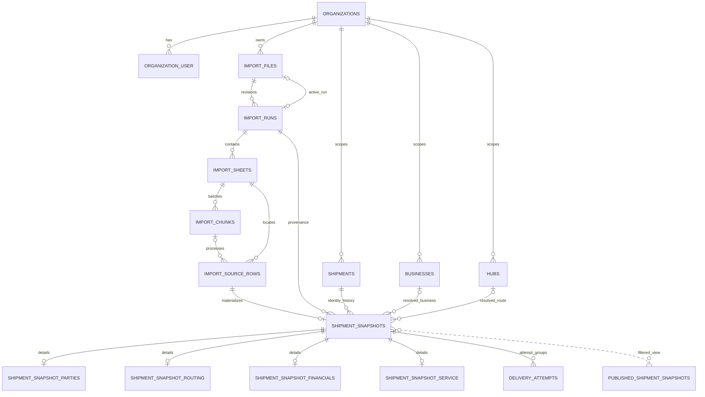

# تقرير المرحلة 01 — معمارية قاعدة البيانات

**الحالة:** اكتملت المرحلة 01؛ التنفيذ محصور في Backend وMySQL والتوثيق والاختبارات. لم تبدأ المرحلة 02 أو محرك استيراد Excel أو إعادة بناء React.
**التاريخ:** 2026-11-03 (Africa/Cairo)
**الفرع:** `codex/phase-00-baseline`
**المرجع:** مخرجات المرحلة 00، وثيقتا Bosta المرفقتان، وملف Excel الأصلي الموجود في جذر المستودع.

## 1. الخلاصة

المستودع عند بدء العمل كان React 19 وTypeScript وVite فقط. أُضيف Backend مستقل بـLaravel 12.70.2، واختير Laravel 12 لأن PHP المتاح مباشرة على الجهاز هو PHP 8.2.4. Composer هو 2.11.1، ومحرك قاعدة الاختبار هو MySQL Community 8.4.13 مع InnoDB. تشغيل MySQL وPHP محلي ومباشر؛ لم يُستخدم Docker أو Container Runtime.

اكتمل تصميم العلاقات والمؤسسات والاستيراد وإصداراته والصفوف الخام وهوية الشحنة وSnapshots التاريخية ومحاولات التسليم والتدقيق. يغطي الـschema كل أعمدة Manifest الـ211، وتُحفظ القيم الأصلية كسجل خلايا مصدر مكمّل للأعمدة المهيكلة. لا يوجد قيد Unique على Tracking. يوجد View للتقارير لا يعرض إلا التشغيل المنشور النشط. إعداد Queue هو Database Queue، ولم يبدأ Worker.

الملف الأصلي لم يتغير، وبصمته SHA-256 هي `41344719F17C199ED39ACE7C51BD3D684F1DDA29C201C81D78D055482585C99B`. أضيف استثناء Git لملفات التصدير الأصلية كي لا تُدرج بالغلط؛ تُحفظ إحصاءات منقحة فقط في المرحلة 00.

## 2. فحص ملف Excel ومطابقة Manifest

| الفحص | النتيجة |
|---|---|
| الملف/الورقة | ملف واحد؛ ورقة `Deliveries`؛ العناوين في الصف الأول؛ صف بيانات واحد؛ لا خلايا معادلات |
| العناوين | 207 عنوانًا موجودًا، وكلها مطابقة للـManifest؛ لا عنوان زائد أو مكرر |
| عناوين Manifest الغائبة | `Current Hub Display Code`، `Current Parent Hub Display Code`، `Assigned Hub Display Code`، `Assigned Parent Hub Display Code` |
| القيم | 59 خلية غير فارغة؛ كلها خلايا نصية؛ 148 عمودًا موجودًا في الورقة فارغة في الصف الوحيد؛ 16 قيمة تبدو رقمية و9 تبدو تواريخ لكن الخلايا نفسها نصية |
| الطول | أطول قيمة مرصودة 73 محرفًا؛ لا يثبت ذلك الحد الأقصى لأي حقل |
| المحاولات | العناوين الـ72 موجودة في Manifest؛ خلايا مجموعات Attempt 0–8 كلها فارغة في الصف الوحيد |
| التكرار | Tracking ظهر مرة واحدة؛ العينة لا تسمح بتحديد قواعد التكرار أو نطاق التفرد |
| تاريخ الملف | `2026-09-28` مرشح من اسم الملف فقط؛ لم يُعتمد كتاريخ تقرير |

التحليل الكامل المعاد إنتاجه موجود في [ملف Profiling المنقح](../phase-00/original_excel_profile.json) وأداته للقراءة فقط [profile-original-excel.mjs](../phase-00/profile-original-excel.mjs). عدم وجود قيم في أربعة أعمدة في الملف لا يمنع تخزينها؛ الأعمدة موجودة في الـschema وتقبل `NULL`. لم يُستخدم Excel لاستنتاج طول نهائي أو Nullability أو نوع منطقي.

تمت مطابقة [Manifest المرحلة 00](../phase-00/bosta_211_column_manifest.json) حرفيًا مع `backend/config/bosta_columns.json` ومع النسخة المجمّدة للمigrations `backend/database/schema/bosta_columns_v1.json`. اختبار الوحدة يتحقق من تطابقها ومن أرقام المصدر والعناوين وتوزيع المجموعات.

## 3. قرارات أنواع البيانات وحفظ المصدر

| مجموعة القيم | العمود المهيكل | قرار المرحلة 01 وحدوده |
|---|---|---|
| نصوص ومعرّفات وTracking | `LONGTEXT NULL` | لا حد طول مفترض ولا تحويل إلى رقم؛ تحفظ الأصفار البادئة. لا توجد Unique على Tracking أو Business ID أو أسماء المراكز |
| تواريخ وأوقات | `DATETIME(6) NULL` | يحفظ دقة الميكروثانية؛ لا قيمة افتراضية لليوم ولا افتراض لمنطقة وقت الحدث. نوع Excel المرصود نصي ولا يثبت الصيغ المقبولة |
| مبالغ وأوزان وتقييمات | `DECIMAL(65,30) NULL` | أوسع دقة/مقياس يدعمه MySQL 8.4 لتجنب التضييق اعتمادًا على عينة واحدة؛ يبقى هذا حدًا ماديًا يجب مراجعته بعد Profiling تقارير متنوعة. القيم الأصلية تبقى في سجل المصدر إذا تعذر التحويل |
| أعداد | `BIGINT UNSIGNED NULL` | نطاق أوسع من `unsignedInteger` المبدئي في Manifest؛ القيم الفارغة تبقى فارغة |
| Boolean | `TINYINT(1) NULL` عبر MySQL Boolean | لا يُعتمد تفسير رموز النصوص إلى true/false قبل توثيق قيم المصدر؛ قيمة المصدر الأصلية محفوظة |
| كل خلايا الصف | `import_source_rows.source_values JSON` | سجل مساعد بمفتاح رقم عمود المصدر وقيمته الأصلية. لا يستبدل الأعمدة الـ211 الفعلية؛ الملف الأصلي محفوظ خاصًا مع SHA-256 ومصدر الورقة/الصف |

النصوص لا تستخدم طول Manifest المبدئي `string(100/191)` كحد تخزين، لأن العينة لا تثبت هذه الحدود. أسماء أعمدة المصدر ومواضعها مثبتة في ملف نسخة المخطط v1؛ أي تغيير مستقبلي يكون بإصدار جديد ومigration لاحقة، لا بتعديل ملف migration قديم.

## 4. Schema Inventory

هناك 27 جدولًا وظيفيًا جديدًا و8 جداول Laravel القياسية، بالإضافة إلى جدول `migrations` الداخلي وView واحد للتقارير. قواعد البيانات تستخدم InnoDB و`utf8mb4`، وقيود الحذف الخارجية `RESTRICT` لحفظ السجل التاريخي.

| المجال | الجداول | الغرض |
|---|---|---|
| المنظمة والصلاحيات | `organizations`, `organization_user`, `roles`, `permissions`, `permission_role`, `organization_settings`, `user_hub_access`, `users` | عضوية وصلاحيات مفصولة حسب المؤسسة؛ المستخدم عالمي وله عضويات مؤسسات. الأدوار ضمن مؤسسة والصلاحيات قاموس مركزي |
| معاجم الأعمال والمراكز | `businesses`, `hubs`, `hub_aliases`, `locations` | فصل التسميات الواردة عن معرّفات الأعمال/المراكز الموحدة؛ حقول الـSnapshot الأصلية تبقى محفوظة حتى عند غياب المطابقة |
| الملف والتشغيل | `import_files`, `import_runs`, `import_sheets`, `import_chunks`, `import_source_rows`, `import_issues`, `column_mappings`, `report_exports` | SHA-256 وRevisions وتاريخ تقرير اختياري ومصدر الملف والورقة والصف، Idempotency ومشاكل آمنة وتصديرات غير متزامنة لاحقًا |
| هوية الشحنة وتاريخها | `shipments`, `shipment_snapshots`, `shipment_snapshot_parties`, `shipment_snapshot_routing`, `shipment_snapshot_financials`, `shipment_snapshot_service`, `delivery_attempts` | هوية منفصلة عن ظهور الشحنة في كل صف مصدر؛ تفاصيل 1:1 ومحاولات 0–8 كسجلات مستقلة |
| تدقيق ونشر | `audit_logs`, `published_shipment_snapshots` (View) | سجل تدقيق محدود البيانات؛ مصدر تقارير لا يعرض إلا Snapshot لتشغيل منشور ونشط |
| Laravel | `password_reset_tokens`, `sessions`, `cache`, `cache_locks`, `jobs`, `job_batches`, `failed_jobs` مع `users` أعلاه | مصادقة الجلسة وCache وDatabase Queue القياسية؛ لا Redis أو Horizon |

### تغطية الـ211 عمودًا

| جدول المصدر المهيكل | حقول Manifest | الموجود الفعلي في MySQL |
|---|---:|---:|
| `shipment_snapshots` | 49 | 49 |
| `shipment_snapshot_parties` | 22 | 22 |
| `shipment_snapshot_routing` | 22 | 22 |
| `shipment_snapshot_financials` | 24 | 24 |
| `shipment_snapshot_service` | 22 | 22 |
| `delivery_attempts` | 72 | 8 أعمدة مهيكلة × 9 سجلات مرتبطة بالـSnapshot |
| **الإجمالي** | **211** | **211** |

تتضمن `delivery_attempts` مفتاح مجموعة `attempt_index` من 0 إلى 8 وUnique على `(organization_id, shipment_snapshot_id, attempt_index)` وCHECK في MySQL يمنع رقمًا خارج المجال. هذا يتيح حفظ المجموعة حتى عند فراغ قيمها، ولا يفترض أن المجموعة 0 هي الأحدث.

### Migration Inventory

| Migration | ما تنشئه |
|---|---|
| `0001_01_01_000000_create_users_table` | مستخدمون، إعادة تعيين كلمة مرور، جلسات Laravel |
| `0001_01_01_000001_create_cache_table` | Cache وCache locks من قاعدة البيانات |
| `0001_01_01_000002_create_jobs_table` | Laravel jobs وbatches وfailed jobs |
| `2026_11_03_000001_create_organizations_and_access_tables` | المؤسسات والأعضاء والأدوار والصلاحيات والإعدادات |
| `2026_11_03_000002_create_logistics_dimensions` | الأعمال والمراكز والمرادفات والمواقع وصلاحيات المراكز |
| `2026_11_03_000003_create_import_management_tables` | الملفات والإصدارات والأوراق والدفعات والصفوف والمشاكل والمابنج والتصدير |
| `2026_11_03_000004_create_shipments_and_snapshots` | هوية الشحنة و49 عمود Snapshot وعلاقات الأعمال والمراكز |
| `2026_11_03_000005_create_snapshot_details_and_attempts` | جداول التفاصيل الأربعة و8 أعمدة سجل المحاولة وقيد 0–8 |
| `2026_11_03_000006_create_audit_logs_table` | تدقيق المؤسسة/المستخدم/الحدث دون بيانات خلايا |
| `2026_11_03_000007_create_published_snapshots_view` | View لمصدر التقارير المنشورة النشطة |

### قواعد التكرار والتواريخ والسجل التاريخي

- لا توجد Unique على Tracking؛ بصمة Tracking مفهرسة وغير فريدة. القيمة الأصلية `LONGTEXT`، والظهور التاريخي لكل صف Snapshot مستقل.
- Idempotency مصدر الصف `(import_run_id, import_sheet_id, source_row_number)`؛ إعادة محاولة كتابة الصف ذاته لا تنشئ نسخة ثانية، بينما تكرار Tracking في صف مصدر آخر يبقى محفوظًا.
- Revision فريد داخل ملف `(import_file_id, revision)`؛ SHA-256 مفهرس وغير فريد، فلا تمنع إعادة رفع المحتوى أو تفرض استبدالًا صامتًا.
- `report_date` اختياري على `import_runs` بلا افتراضي. `report_timezone` صريح عند توفره. أولوية override/اسم الملف/اسم الورقة وطرق حل اختلاف التواريخ لم تعتمد بعد.
- علاقة Snapshot تحفظ `shipment_id`, `import_run_id`, `import_source_row_id`، وصف المصدر يحفظ الورقة ورقم الصف. المحاولات تحفظ المجموعة كما وردت بلا إعادة ترتيب.
- الحقول الفارغة تقبل `NULL`؛ لا يستبدل `Items` الفارغ بالرقم 1.
- المايجريشن لا يفرض أن التشغيل اكتمل. الـView يتطلب أن يكون `status='published'` و`published_at` غير فارغ وأن يطابق `import_files.active_run_id`. مسار النشر الذي يجتاز Quality Gate لم يُنفذ بعد؛ أي تقرير رسمي لاحق يجب أن يقرأ من `PublishedShipmentSnapshot` أو الـView.

## 5. Eloquent Models and Relationships

تم إنشاء Models للمنظمة والعضو والصلاحيات، والأعمال والمراكز، والملف والتشغيل والورقة والدفعة وصف المصدر والمشكلة والمابنج، وهوية الشحنة وSnapshot وأجزائه الأربعة والمحاولات وسجل التدقيق والتصدير وView التقارير.

`TenantModel` يستخدم Global Scope مرتبطًا بـ`OrganizationContext`. دون تعيين مؤسسة، الاستعلامات لا تعيد بيانات؛ وهذا يجعل الفشل مغلقًا. عمليات الخلفية القادمة يجب أن تضبط المؤسسة صراحة، وMiddleware المرحلة التالية يجب أن يثبت العضوية قبل تعيين السياق. الحقول محمية من Mass Assignment افتراضيًا، و`User` يحتفظ بقائمة صريحة للحقول القابلة للإسناد.

المفاتيح الخارجية المركبة تشمل `organization_id` في ربط الملف بالتشغيل والورقة والدفعة والصف والـSnapshot والأعمال والمراكز والعضو. هذا يمنع ربط سجل مؤسسة A بسجل مؤسسة B حتى عند معرفة ULID. الحذف مقيد لتفادي فقد السجل التاريخي. علاقة `audit_logs.subject_type/subject_id` عامة ولا يمكن فرض FK لها على عدة جداول؛ تبقى أحداث التدقيق محفوظة ولو حُذف موضوعها، بينما المؤسسة والفاعل مرتبطان بقيود مرجعية.

### Entity Relationship Diagram

## 6. Index Matrix

المصفوفة تلخص كل جدول التطبيق، المفاتيح والفهارس الثانوية وأعمدتها **بالترتيب الفعلي**. فهارس FK التي أنشأها MySQL لدعم مفاتيح مركبة مسماة باسم القيد ومذكورة في الخانة. `PRIMARY` ثابت لكل جدول؛ الـFK وUnique إلزامية للتكامل. الفهارس غير الفريدة تخدم استعلامات متوقعة، ويجب مراجعة كلفتها عبر Query Plan بعد توفر بيانات متعددة التقارير.

| الجدول | الفهرس والأعمدة بالترتيب | الاستخدام | الأثر/التصنيف |
|---|---|---|---|
| `organizations` | `PRIMARY(id)`؛ `organizations_slug_unique(slug)` | تحميل المؤسسة ومعرّفها العام | إلزامي: PK وUnique |
| `users` | `PRIMARY(id)`؛ `users_email_unique(email)` | حساب المستخدم وتسجيل الدخول | إلزامي؛ لا بحث على PII آخر |
| `roles` | `PRIMARY(id)`؛ `roles_organization_id_slug_unique(organization_id,slug)`؛ `roles_id_org_unique(id,organization_id)` | أدوار المؤسسة وعلاقة عضوية مركبة | إلزامي؛ كلفة فحص Unique أثناء الكتابة |
| `permissions` | `PRIMARY(id)`؛ `permissions_name_unique(name)` | قاموس الصلاحيات | إلزامي |
| `permission_role` | `PRIMARY(id)`؛ `permission_role_role_id_permission_id_unique(role_id,permission_id)`؛ `permission_role_permission_id_foreign(permission_id)` | ربط الصلاحية بالدور | إلزامي للتكرار وFK |
| `organization_user` | `PRIMARY(id)`؛ `organization_user_organization_id_user_id_unique(organization_id,user_id)`؛ `organization_user_organization_id_status_user_id_index(organization_id,status,user_id)`؛ `organization_user_role_org_fk(role_id,organization_id)`؛ `organization_user_user_id_foreign(user_id)` | عضويات المؤسسة وحالة الوصول والدور | Unique/FK إلزامية؛ فهرس الحالة يضيف كلفة كتابة بسيطة |
| `organization_settings` | `PRIMARY(id)`؛ `organization_settings_organization_id_setting_key_unique(organization_id,setting_key)` | إعدادات المؤسسة | إلزامي |
| `businesses` | `PRIMARY(id)`؛ `businesses_id_org_unique(id,organization_id)`؛ `businesses_organization_id_external_id_hash_index(organization_id,external_id_hash)` | حل معرّف Business ضمن مؤسسة | الأولان للتكامل؛ hash للبحث، غير فريد |
| `hubs` | `PRIMARY(id)`؛ `hubs_id_org_unique(id,organization_id)`؛ `hubs_organization_id_canonical_name_hash_index(organization_id,canonical_name_hash)`؛ `hubs_organization_id_external_code_hash_index(organization_id,external_code_hash)` | البحث عن مركز/كود داخل المؤسسة | hash indexes غير فريدة؛ كلفة إدخال/تحديث لكل فهرس |
| `hub_aliases` | `PRIMARY(id)`؛ `hub_aliases_hub_org_fk(hub_id,organization_id)`؛ `hub_aliases_organization_id_source_name_hash_index(organization_id,source_name_hash)`؛ `hub_aliases_org_hub_hash_unique(organization_id,hub_id,source_name_hash)` | حل اسم المصدر وعرض مرادفات مركز ومنع تكرار المرادف على المركز نفسه | FK/Unique إلزامية؛ بحث الاسم يظل غير فريد لأن alias قد يطابق أكثر من مركز |
| `locations` | `PRIMARY(id)`؛ `locations_organization_id_kind_source_name_hash_index(organization_id,kind,source_name_hash)` | اقتراح مطابقات موقع/منطقة حسب المؤسسة والنوع | مرشح للتحقق بقياسات؛ كلفة فهرس إضافي |
| `user_hub_access` | `PRIMARY(id)`؛ `user_hub_access_organization_id_user_id_hub_id_unique(organization_id,user_id,hub_id)`؛ `user_hub_access_organization_id_hub_id_user_id_index(organization_id,hub_id,user_id)`؛ `user_hub_access_member_org_fk(organization_id,user_id)`؛ `user_hub_access_hub_org_fk(hub_id,organization_id)` | صلاحيات المستخدم على المركز | Unique/FK إلزامية؛ الفهرس العكسي لخيار قائمة المستخدمين حسب المركز |
| `import_files` | `PRIMARY(id)`؛ `import_files_id_org_unique(id,organization_id)`؛ `import_files_organization_id_sha256_index(organization_id,sha256)`؛ `import_files_organization_id_created_at_index(organization_id,created_at)`؛ `import_files_active_run_fk_index(active_run_id,id,organization_id)` | الملفات حسب المؤسسة/البصمة/الوقت، والتحقق من التشغيل النشط | SHA غير فريد؛ فهارس FK ووقت قائمة الملفات إلزامية؛ كل فهرس يزيد كلفة كتابة الملف |
| `import_runs` | `PRIMARY(id)`؛ `import_runs_import_file_id_revision_unique(import_file_id,revision)`؛ `import_runs_id_org_unique(id,organization_id)`؛ `import_runs_id_file_org_unique(id,import_file_id,organization_id)`؛ `import_runs_organization_id_status_created_at_index(organization_id,status,created_at)`؛ `import_runs_organization_id_report_date_status_index(organization_id,report_date,status)`؛ `import_runs_file_org_fk(import_file_id,organization_id)` | Revisions وحالة التشغيل وتاريخ التقرير | Unique/FK إلزامية؛ الفهرسان المركبان يدعمان قائمة التشغيل والتقارير |
| `import_sheets` | `PRIMARY(id)`؛ `import_sheets_import_run_id_source_sheet_index_unique(import_run_id,source_sheet_index)`؛ `import_sheets_id_run_org_unique(id,import_run_id,organization_id)`؛ `import_sheets_organization_id_import_run_id_index(organization_id,import_run_id)`؛ `import_sheets_run_org_fk(import_run_id,organization_id)` | منع إعادة الورقة داخل التشغيل وجلب أوراقه | Unique/FK إلزامية؛ فهرس الجلب يبدأ بالمؤسسة |
| `import_chunks` | `PRIMARY(id)`؛ `import_chunks_import_run_id_import_sheet_id_chunk_index_unique(import_run_id,import_sheet_id,chunk_index)`؛ `import_chunks_id_run_sheet_org_unique(id,import_run_id,import_sheet_id,organization_id)`؛ `import_chunks_organization_id_import_run_id_status_index(organization_id,import_run_id,status)`؛ `import_chunks_run_org_fk(import_run_id,organization_id)`؛ `import_chunks_sheet_run_org_fk(import_sheet_id,import_run_id,organization_id)` | استئناف دفعات التشغيل وحالتها | Idempotency/FK إلزامية؛ status index للاستعلامات المتوقعة |
| `import_source_rows` | `PRIMARY(id)`؛ `source_rows_idempotency_unique(import_run_id,import_sheet_id,source_row_number)`؛ `source_rows_id_run_org_unique(id,import_run_id,organization_id)`؛ `import_source_rows_organization_id_import_run_id_status_index(organization_id,import_run_id,status)`؛ `source_rows_sheet_run_org_fk(import_sheet_id,import_run_id,organization_id)`؛ `source_rows_chunk_run_sheet_org_fk(import_chunk_id,import_run_id,import_sheet_id,organization_id)` | منع إعادة كتابة الصف وجلب صفوف التشغيل/الحالة | Unique/FK إلزامية؛ status index يخدم Queue/معاينة التشغيل |
| `import_issues` | `PRIMARY(id)`؛ `import_issues_organization_id_import_run_id_severity_index(organization_id,import_run_id,severity)`؛ `import_issues_import_source_row_id_issue_code_index(import_source_row_id,issue_code)`؛ `import_issues_run_org_fk(import_run_id,organization_id)`؛ `import_issues_source_run_org_fk(import_source_row_id,import_run_id,organization_id)` | تقرير مشاكل التشغيل والانتقال إلى صف بعينه | FK إلزامية؛ فهرسان ثانويان لتصفح الأخطاء |
| `column_mappings` | `PRIMARY(id)`؛ `column_mappings_version_number_unique(organization_id,mapping_version,source_column_number)`؛ `column_mappings_organization_id_mapping_version_is_enabled_index(organization_id,mapping_version,is_enabled)`؛ `column_mappings_created_by_foreign(created_by)` | إصدار المابنج وقراءة الحقول النشطة | Unique/FK إلزامية؛ فهرس قراءة حسب الإصدار والحالة |
| `report_exports` | `PRIMARY(id)`؛ `report_exports_organization_id_status_created_at_index(organization_id,status,created_at)`؛ `report_exports_requester_org_fk(organization_id,requested_by)` | سجل التصدير حسب المؤسسة والحالة والطالب | FK إلزامي؛ فهرس الحالة مهم إذا كثر سجل التصدير |
| `shipments` | `PRIMARY(id)`؛ `shipments_id_org_unique(id,organization_id)`؛ `shipments_tracking_lookup_index(organization_id,tracking_fingerprint)` | هوية داخل المؤسسة وبحث Tracking ببصمة غير فريدة | لا Unique على البصمة؛ الفهرس يزيد كلفة الكتابة ويحتاج مفتاح HMAC ثابتًا |
| `shipment_snapshots` | `PRIMARY(id)`؛ `shipment_snapshots_id_org_unique(id,organization_id)`؛ `shipment_snapshots_source_row_unique(import_source_row_id)`؛ `snapshots_shipment_history_index(organization_id,shipment_id,import_run_id)`؛ `snapshots_run_index(organization_id,import_run_id)`؛ `snapshots_business_run_index(organization_id,business_id,import_run_id)`؛ `snapshots_current_hub_run_index(organization_id,current_hub_id,import_run_id)`؛ `snapshots_assigned_hub_run_index(organization_id,assigned_hub_id,import_run_id)`؛ `snapshots_state_run_index(organization_id,delivery_state_fingerprint,import_run_id)`؛ وFK indexes للمؤسسة/الشحنة/التشغيل/صف المصدر/Business والمراكز | تاريخ الشحنة حسب التشغيل ومرشحات الأعمال/المراكز/الحالة | مصدر كتابة كثيف مستقبلًا؛ هذه الفهارس تغطي مرشحات معروفة فقط. بصمة الحالة غير فريدة ولا فهرسة لنص PII |
| `shipment_snapshot_parties` | `PRIMARY(id)`؛ `shipment_snapshot_parties_snapshot_unique(organization_id,shipment_snapshot_id)`؛ `shipment_snapshot_parties_snapshot_org_fk(shipment_snapshot_id,organization_id)` | تفاصيل الأطراف 1:1 مع Snapshot | Unique/FK؛ لا فهرسة للأسماء أو الهاتف أو العناوين |
| `shipment_snapshot_routing` | `PRIMARY(id)`؛ `shipment_snapshot_routing_snapshot_unique(organization_id,shipment_snapshot_id)`؛ `shipment_snapshot_routing_snapshot_org_fk(shipment_snapshot_id,organization_id)` | حقول التوجيه 1:1 مع Snapshot | Unique/FK؛ المعرفات الموحدة مفهرسة في الجدول الأب |
| `shipment_snapshot_financials` | `PRIMARY(id)`؛ `shipment_snapshot_financials_snapshot_unique(organization_id,shipment_snapshot_id)`؛ `shipment_snapshot_financials_snapshot_org_fk(shipment_snapshot_id,organization_id)` | تفاصيل المال 1:1 | Unique/FK؛ لا فهرسة للمبالغ دون Query Plan يثبت ذلك |
| `shipment_snapshot_service` | `PRIMARY(id)`؛ `shipment_snapshot_service_snapshot_unique(organization_id,shipment_snapshot_id)`؛ `shipment_snapshot_service_snapshot_org_fk(shipment_snapshot_id,organization_id)` | تفاصيل الخدمة 1:1 | Unique/FK؛ لا فهرسة على ملاحظات/تعليقات/أسباب |
| `delivery_attempts` | `PRIMARY(id)`؛ `delivery_attempt_group_unique(organization_id,shipment_snapshot_id,attempt_index)`؛ `attempts_snapshot_org_fk(shipment_snapshot_id,organization_id)` | جلب محاولات Snapshot ومنع ازدواج رقم المجموعة | Unique/FK إلزامية؛ 9 سجلات كحد أقصى لكل Snapshot |
| `audit_logs` | `PRIMARY(id)`؛ `audit_org_time_index(organization_id,created_at)`؛ `audit_subject_time_index(organization_id,subject_type,subject_id,created_at)`؛ `audit_actor_time_index(organization_id,actor_id,created_at)`؛ `audit_actor_org_fk(organization_id,actor_id)` | سجل الأحداث حسب الزمن أو الهدف أو الفاعل | ثلاث فهارس ثانوية؛ كلفتها مع كل إدراج مقبولة لسجل تدقيق قابل للمراجعة |
| `sessions` / `cache` / `cache_locks` | المفاتيح الأساسية؛ `sessions_user_id_index(user_id)`؛ `sessions_last_activity_index(last_activity)`؛ `cache_expiration_index(expiration)`؛ `cache_locks_expiration_index(expiration)` | إدارة Laravel | فهارس إطار العمل؛ أزيل خيار Redis كشرط |
| `jobs` / `job_batches` / `failed_jobs` | المفاتيح الأساسية؛ `jobs_queue_index(queue)`؛ `failed_jobs_uuid_unique(uuid)` | Queue قاعدة البيانات وإعادة المحاولة | فهارس Laravel؛ لم يبدأ عامل محليًا |
| `password_reset_tokens` / `migrations` | PK(`email`) وPK(`id`) | إدارة إطار Laravel | فهارس نظامية إلزامية |
| `published_shipment_snapshots` (View) | بلا فهرس مستقل؛ يعتمد على فهارس جداول المصدر أعلاه | يعرض التشغيل النشط المنشور فقط | الـJOIN يستخدم المفاتيح الموجودة؛ تحقق الخطة عند بناء التقارير |

لا يوجد فهرس لكل واحد من حقول المصدر. أسماء/هواتف/عناوين الطرف وNotes والتعليقات لا تفهرس. كل أعمدة الـSnapshot من نوع تاريخ/مال/عدّاد تُستعلم عبر تشغيل التقرير أو المعرّفات المقابلة، وتضاف فهارس لاحقًا فقط عند ظهور استعلام فعلي وقياس.

## 7. نتائج الاختبارات

نفذت الاختبارات ببيانات اصطناعية قصيرة على MySQL 8.4.13 وقاعدة `bosta_analysis_test` منفصلة عن `bosta_analysis_local`. إعداد قاعدة الاختبار محلي داخل `.env.testing` المستثنى من Git. لم يستخدم الاختبار ملف Excel الأصلي أو بيانات عملاء حقيقية.

| التحقق | النتيجة |
|---|---|
| `php artisan migrate:fresh --env=testing --force` | PASS؛ جميع migrations القياسية ومرحلة 01 نجحت |
| تغطية الـManifest ونسخة Migration ونسخة Runtime | PASS؛ 211/211 وتوزيع الجداول مطابق |
| Attempt groups | PASS؛ 9 مجموعات × 8 حقول؛ DB CHECK يرفض المجموعة 9 |
| حفظ Track/تاريخ/مبلغ/NULL | PASS؛ الأصفار البادئة، DATETIME(6)، DECIMAL، وNULL بقيت صحيحة، مع نسخة المصدر الأصلية |
| العلاقات التاريخية وFK | PASS؛ الملف ← التشغيل ← الورقة/الصف ← Snapshot ← المحاولات |
| Idempotency والتكرار | PASS؛ إعادة صف المصدر نفسه مرفوضة، وتكرار Tracking في صف آخر محفوظ |
| عزل المؤسسة | PASS؛ الاستعلام دون سياق لا يعيد بيانات؛ FK يرفض ربط شحنة مؤسسة أخرى |
| عدم إظهار تشغيل غير مكتمل | PASS؛ View لا يعرض Snapshot قبل `published` و`published_at` ومطابقة التشغيل النشط |
| Migrations rollback | PASS؛ `migrate:reset` ثم إعادة Migrate شملتا migrations 1–7 على قاعدة الاختبار المنفصلة، بما فيها إسقاط وإعادة إنشاء View |
| Laravel tests | PASS؛ 13 اختبارًا و77 assertion في آخر تشغيل |
| PHP وPint | PASS؛ فحص syntax لـ51 ملف PHP وLaravel Pint بلا تغييرات متبقية |
| اختبار حمل/ذاكرة | لم يُنفذ؛ غير مطلوب وممنوع على الجهاز المحلي المحدود |
| Redis/Horizon/Worker | لم يُشغّل أي منها |

## 8. مخطط فحوص التشغيل والحجم الكبير

- بيئة الاختبار استعملت MySQL 8.4.13 محليًا على المنفذ 3307، InnoDB buffer pool قدره 128 MiB وحد اتصال أقصى 24؛ المنفذ مرتبط بـ`127.0.0.1`. لم يبدأ معها أي Worker إضافي.
- قاعدة التطبيق `bosta_analysis_local` منفصلة عن قاعدة الاختبار؛ صلاحية كل حساب محصورة في قاعدة بيئته. ملفات `.env` وبيانات MySQL تحت `backend/.local` لا تدخل Git.
- Composer مضبوط على autoloader غير محسّن في التطوير لتخفيف زمن/ذاكرة الإعداد على الجهاز؛ بناء نشر مناسب يستخدم `composer install --optimize-autoloader`.
- Queue الافتراضي Database. لا تبدأ `queue:work` الآن لأن Jobs الاستيراد ليست ضمن المرحلة. في مرحلة Queue استخدم Worker واحد محليًا عند وجود أعمال فعلية؛ Redis/Horizon وعدة Workers خيار نشر منفصل.
- محرك استيراد Excel غير منشأ. الخطة اللاحقة تستخدم قراءة متدفقة/دفعات صغيرة، قيود Idempotency، معاملات قصيرة، وكتابة bulk؛ 500–1000 صف بداية قياس لا قيمة نهائية. يجب ألا تُحمّل واجهة API كل XLSX أو كل الشحنات إلى الذاكرة.
- لا Partitioning أو Summary Tables قبل قياس حجم حقيقي. لا توجد نتائج EXPLAIN/Performance Schema بعد؛ الفهارس الآن مبنية على مسارات المصدر المعروفة، وتحتاج ضبطًا على بيانات تشغيل متعددة.

## 9. قرارات مؤقتة وأسئلة غير محسومة

1. ملف المصدر المتاح يفتقد أربعة عناوين Manifest؛ نحتاج عينة من تصديرات أخرى لتحديد هل هي حقول اختيارية أم اختلاف نسخة.
2. نوع/صيغة/منطقة وقت كل تاريخ ما زالت غير مؤكدة؛ `report_date` مستقل ولا يملأ من تاريخ اليوم أو من اسم الملف تلقائيًا.
3. أطوال النصوص والـNullability والتنوع الفعلي للقيم لم يثبتها صف واحد. الحقول النصية `LONGTEXT` مؤقتًا؛ حقل التاريخ/Boolean/الأعداد/Decimal تحتاج Profiling متعدد الملفات قبل تثبيت قواعد التحويل.
4. `DECIMAL(65,30)` أوسع تمثيل MySQL لكن له حد؛ إذا تجاوزته قيمة، تبقى القيمة الأصلية في المصدر وتحتاج تسجيل Issue بدل قبول تقريبها. عملة كل عمود وقواعد التقريب غير معتمدة.
5. نطاق Tracking (مؤسسة/Business/شركة ناقلة) وتكراره داخل الملف/اليوم لم يعتمدا؛ لا Unique ولا حذف تلقائي.
6. بصمة Tracking/الحالة ومعاجم الأسماء تتطلب HMAC بمفتاح بحث ثابت محفوظ كسر؛ تدوير المفتاح وإصدارات البصمة لم ينفذا، ويجب اعتماد خطة تدوير قبل تخزين بيانات فعلية.
7. دلالة المجموعة 0–8 ترتيبًا/محاولةً غير محسومة؛ يحفظ `attempt_index` ترتيب المصدر فقط.
8. مسار رفع الملف الخاص، فحص MIME، Authorization middleware، Quality Gate، نشر التشغيل ذريًا، سياسة Retention/Masking، وAPI لم تنفذ في هذه المرحلة. الـView يمنع ظهور تشغيل غير منشور عند استعماله، لكنه لا ينفذ بنفسه Quality Gate.
9. PHP المتاح هو 8.2.4؛ الاختيار الحالي Laravel 12. وفق جدول دعم Laravel الرسمي ينتهي دعم أمان Laravel 12 في فبراير 2027. قبل استخدام طويل أو نشر، يلزم تحديث PHP إلى إصدار مدعوم أحدث ثم مراجعة الانتقال إلى Laravel 13؛ هذا لم يُنفذ لأن بيئة PHP 8.3 المتاحة محليًا افتقرت إلى DOM في اختبار PHPUnit. راجع [إصدارات Laravel الرسمية](https://laravel.com/docs/13.x/releases) و[تثبيت MySQL على Windows](https://dev.mysql.com/doc/refman/8.4/en/windows-installation.html).
10. لا يوجد نشر أو بيانات إنتاجية. التطبيق الحالي React يظل كما هو؛ الربط ونقل واجهة التحليلات مرحلة لاحقة.

## 10. جاهزية المرحلة 02

قاعدة البيانات وModels وقيود التكامل متاحة لبناء مصادقة المؤسسة وMiddleware/Policies واختبارات وصول المرحلة 02، لكن اختيار Laravel/PHP على المدى الطويل، قواعد Tracking/Date، HMAC key، وأربعة عناوين ناقصة تظل قرارات مراجعة. لم تبدأ أي أعمال من المرحلة 02. يتوقف التنفيذ هنا إلى أن يراجع المستخدم هذا التقرير ويأذن بالمرحلة التالية.
